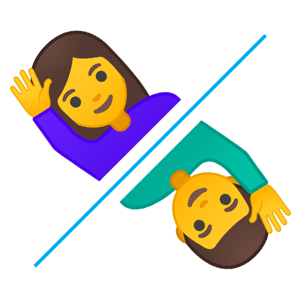

<div align="center">
    <h1>🤵 Mann eller Kvinne? 💃</h1>
    <p>En nettside som gjetter om du er mann eller kvinne basert på hva du skriver</p>
    

<a href="README-en.md">🇬🇧 English</a>

</div>

_Dette er repoet for backenden til prosjektet mann-eller-kvinne. Frontenden kan du finne [her](https://github.com/LBlend/mann-eller-kvinne-frontend)._

Nettsida gjetter om du er mann eller kvinne ved bruk av enkel maskinlæring.
Maskinlæringsmodellen er trent på over 3000 anmeldelser fra norsk media og har som formål å finne ut av hva som skiller kvinner og menn skriftlig.

Konseptet er inspirert av debatten som oppstod i Berteheussen-saken, hvor det skal ha blitt diskutert hvorvidt det er en mann som kan ha skrevet trusselbrevene som er omtalt. Dette på grunn av at ordet "tisse" ble brukt fremfor ordet "pisse". Du kan lese mer om saken [her](https://www.nrk.no/kultur/uenige-om-bruken-av-ordet-_tisse_-1.15206839)

Om du mener at denne kan forbedres, kan du gjerne bidra. Har du kunnskap om maskinlæring så er det bare å åpne opp din favoritteditor og hive seg på!
Sjekk [bidragsguiden](CONTRIBUTING.md). Om du kan React og webutvikling kan du også bidra med å forbedre frontenden ved å dra til frontendrepoet som er nevnt ovenfor.

## En liten kommentar

Denne nettsiden er laget for å utforske forskjellene mellom menn og kvinner.
Det skal derimot sies at modellen som er brukt for å gjøre antagelser er lite optimert og er basert på en ganske liten mengde data.
Man skal dermed ikke ta denne så seriøst. Dette er bare et prosjekt laget for morrohetens skyld og er ikke ment for bruk til forskning eller andre seriøse formål.

## Kjør selv

<details>
  <summary>Docker</summary>

1. Skriv denne kommandoen for å kjøre backenden.

```
docker run -d -p 5000:5000 --name mann-eller-kvinne-backend ghcr.io/lblend/mann-eller-kvinne:latest
```

Vi anbefaler at du bruker kommandoen gitt ovenfor. Du står derimot fritt til å endre variabler til eget ønske om du vet hva du driver med.

Merk deg at du ikke har mulighet til å endre intern port uten å gjøre endringer i koden.

Merk deg også at ved å bruke ferdigbyggede bilder for både frontend og backend, vil du ikke ha mulighet til å endre port i det hele tatt.

</details>

<details>
  <summary>Manuelt</summary>

0. Last ned repoet og installer avhengigheter

- [uv](https://docs.astral.sh/uv/getting-started/installation/)

1. Kjør installasjon- og treningssskriptet

   ```
   sh build.sh
   ```

_uv installerer riktig Python-versjon og alle avhengigheter automatisk._

2. Kjør APIet
   ```
   uv run uvicorn src.main:app --host 0.0.0.0 --port 5000 --proxy-headers
   ```

</details>

_Det ligger også en [docker-compose](docker-compose.yml) fil i dette repoet som vil sette opp både backend og frontend gjennom Docker. For å konfigurere dem kopierer du [.env.example](.env.example) til `.env` ved siden av `docker-compose.yml`, og setter `ALLOWED_ORIGINS` til adressen til frontenden og `VITE_API_URL` til adressen til backenden. Uten en `.env`-fil kjører begge på `localhost`._

## Takk

Takk til [LtgOslo](https://www.mn.uio.no/ifi/english/research/groups/ltg/) som har laget det taggede korpuset, datasettet, som er brukt til å trene maskinlæringsmodellen.

Du kan finne korpuset som er brukt [her](https://github.com/ltgoslo/norec_gender)

```
@inproceedings{touileb-etal-2020-gender,
    title = "Gender and sentiment, critics and authors: a dataset of {N}orwegian book reviews",
    author = "Touileb, Samia and {\O}vrelid, Lilja and Velldal, Erik",
    booktitle = "Proceedings of the Second Workshop on Gender Bias in Natural Language Processing",
    month = dec,
    year = "2020",
    address = "Barcelona, Spain (Online)",
    publisher = "Association for Computational Linguistics",
    url = "https://www.aclweb.org/anthology/2020.gebnlp-1.11",
    pages = "125--138"
}
```
